<!--
Generated by Merlin Studio (https://app.merlin-studio.cloud).
Licensed under the Apache License, Version 2.0 (https://www.apache.org/licenses/LICENSE-2.0).
-->

# AWS Healthcare Landing Zone — Merlin Studio Example

> 🆓 **Design your own AWS landing zone with Merlin — free, no signup, no email.**
> This repository was generated by Merlin from a single intent spec. Guest mode lets you
> answer the same discovery questions for *your* organization and download your own
> infrastructure-as-code bundle (LZA, OpenTofu, CDK or tfvars) in minutes.
> **[Open Merlin →](https://app.merlin-studio.cloud)**

✉️ **Questions about this example, or need one shaped for your organization?** Write to [intentarcha@gmail.com](mailto:intentarcha@gmail.com?subject=AWS-Healthcare-Example) — questions, corrections and requests are all welcome.

A complete, regulated **AWS multi-account landing zone** for a fictional healthcare
org (**AcmeCorp**), generated by [**Merlin Studio**](https://app.merlin-studio.cloud)
from a single intent spec and emitted in **two infrastructure-as-code formats**.

This repository is a **reference example** — it shows what Merlin produces for a
real-world HIPAA workload, end to end: account hierarchy, networking, security
baseline, logging, backup/DR, and the compliance reasoning behind every choice.

> **Not a turnkey deployment.** All real AWS identifiers are stubbed as
> `PLACEHOLDER_*` tokens and all contact addresses use the reserved `example.com`
> domain. See each format's `PLACEHOLDERS.md` before attempting to deploy.

---

## The scenario

| | |
|---|---|
| **Organization** | AcmeCorp (fictional healthcare provider) |
| **Profile** | standard (mid-size) |
| **Compliance** | CIS · HIPAA · SOC2 |
| **Home region** | us-east-1 |
| **Enabled regions** | us-east-1, us-east-2, us-west-1, us-west-2 |
| **DR posture** | Multi-region warm standby (us-west-2) |
| **Headline control** | Dedicated, SCP-isolated **PhiWorkload** account for ePHI (BAA boundary) |
| **Security scorecard** | **100/100 (A+)** — 314 compliance checks + 288 Checkov checks, 0 failures |

---

## Two formats, one spec

The same intent compiles to two independent deployment paradigms. Pick the one
that matches your stack — each folder is self-contained with its own README,
deployment guide, scorecards, and placeholder list.

| Format | Folder | What it is | Best for |
|---|---|---|---|
| **LZA** | [`LZA/`](./LZA) | AWS Control Tower + Landing Zone Accelerator (declarative YAML) | Regulated enterprises standardizing on AWS-native governance |
| **OpenTofu** | [`OpenTofu/`](./OpenTofu) | OpenTofu + Spacelift (HCL + per-stack YAML) | Teams standardized on Terraform/OpenTofu IaC |

Shared, format-neutral artifacts live at the repository root:

- [`architecture.mmd`](./architecture.mmd) — Mermaid topology diagram (rendered below)
- [`COMPLIANCE_UPGRADES.md`](./COMPLIANCE_UPGRADES.md) — every value a compliance framework forced
- [`NETWORK_TOPOLOGY.md`](./NETWORK_TOPOLOGY.md) — VPCs, CIDRs, Transit Gateway, and DR layout

---

## Architecture

```mermaid
graph TD
    %% AWS Organizations
    Org[AWS Organizations<br/>AcmeCorp]:::org

    %% OUs
    Org --> OU_Security[Security OU]:::ou
    Org --> OU_Workloads[Workloads OU]:::ou
    Org --> OU_Infra[Infrastructure OU]:::ou

    %% Mandatory accounts under Security
    OU_Security --> Acct_LogArchive[LogArchive<br/>Account]:::account
    OU_Security --> Acct_Audit[Audit<br/>Account]:::account

    OU_Infra --> Acct_SharedServices[SharedServices<br/>Account]:::account
    OU_Infra --> Acct_Network[Network<br/>Account]:::account
    OU_Workloads --> OU_Workloads_Dev[Dev]:::ou
    OU_Workloads --> OU_Workloads_Prod[Prod]:::ou

    OU_Workloads --> Acct_Phiworkload[PhiWorkload<br/>Account]:::account
    OU_Workloads_Dev --> Acct_Appdev[AppDev<br/>Account]:::account
    OU_Workloads_Prod --> Acct_Appprod[AppProd<br/>Account]:::account

    %% Security services (run from Audit account)
    Acct_Audit -.delegated.-> GuardDuty[GuardDuty]:::service
    Acct_Audit -.delegated.-> SecurityHub[Security Hub]:::service
    Acct_Audit -.delegated.-> Config[AWS Config<br/>Aggregator]:::service
    Acct_Audit -.delegated.-> AccessAnalyzer[Access Analyzer]:::service
    Acct_Audit -.delegated.-> Macie[Macie]:::service
    Acct_Audit -.delegated.-> Inspector[Inspector]:::service

    %% Logging (LogArchive account)
    Acct_LogArchive --> CentralLogsBucket[(S3 Central<br/>Logs Bucket)]:::s3
    Acct_LogArchive --> CloudTrail[Org CloudTrail<br/>multi-region: true]:::service
    CloudTrail --> CentralLogsBucket
    Config --> CentralLogsBucket

    %% Encryption
    CentralLogsBucket -.encrypts with.-> CMK_Logs[KMS CMK<br/>central-logs-key]:::kms
    CloudTrail        -.encrypts with.-> CMK_Logs

    %% Networking
    Acct_Network --> TGW[Transit Gateway<br/>us-east-1<br/>ASN 64512]:::network
    Acct_Network --> TGW_Secondary[Transit Gateway<br/>us-west-2<br/>ASN 64513]:::network
    TGW <-.peering.-> TGW_Secondary

    %% VPCs
    Network_acct[Network] --> VPC_Hub[hub<br/>10.0.0.0/16]:::vpc
    TGW -.attaches.-> VPC_Hub
    Appprod_acct[AppProd] --> VPC_Workloads[workloads<br/>10.1.0.0/16]:::vpc
    TGW -.attaches.-> VPC_Workloads
    Network_acct[Network] --> VPC_Inspection[inspection<br/>10.5.0.0/16]:::vpc
    TGW -.attaches.-> VPC_Inspection
    Phiworkload_acct[PhiWorkload] --> VPC_Phi[phi<br/>10.3.0.0/16]:::vpc
    TGW -.attaches.-> VPC_Phi
    Network_acct[Network] --> VPC_HubWest[hub-west<br/>10.10.0.0/16]:::vpc
    TGW -.attaches.-> VPC_HubWest
    Appprod_acct[AppProd] --> VPC_WorkloadsWest[workloads-west<br/>10.11.0.0/16]:::vpc
    TGW -.attaches.-> VPC_WorkloadsWest

    %% Backup
    Acct_Audit --> BackupVault[(AWS Backup<br/>Central Vault)]:::backup

    %% IAM Identity Center
    Org -.via.-> IdC[IAM Identity Center<br/>SSO Permission Sets]:::iam

    %% Styling
    classDef org      fill:#ff9900,stroke:#232f3e,color:#000,stroke-width:2px
    classDef ou       fill:#ffd180,stroke:#232f3e,color:#000
    classDef account  fill:#ffe0b2,stroke:#232f3e,color:#000
    classDef service  fill:#0073bb,stroke:#232f3e,color:#fff
    classDef s3       fill:#e8f5e9,stroke:#1b5e20,color:#000
    classDef kms      fill:#fff9c4,stroke:#f57f17,color:#000
    classDef network  fill:#bbdefb,stroke:#0d47a1,color:#000
    classDef vpc      fill:#e3f2fd,stroke:#1565c0,color:#000
    classDef backup   fill:#f8bbd0,stroke:#880e4f,color:#000
    classDef iam      fill:#d1c4e9,stroke:#311b92,color:#000
```

---

## Why HIPAA shapes this zone

A few of the controls Merlin added *because* HIPAA + BAA scope was selected — each
traceable in the per-format README's "What fired for your spec" table:

- **Dedicated `PhiWorkload` account** so SCPs, KMS keys, GuardDuty Malware
  Protection, Macie, and Backup Vault Lock can be scoped to PHI only.
- **Network-isolated PHI VPC** (no public subnets; egress via Transit Gateway to
  centralized inspection) to preserve the BAA boundary.
- **Amazon Macie** for sensitive-data discovery, **Inspector** for CVE scanning,
  **Access Analyzer** to catch policies that share PHI outside the boundary.
- **Immutable audit trail** — Object Lock + CMK encryption + cross-region
  replication of the central log bucket.
- **AWS Backup Vault Lock (COMPLIANCE mode)** with 6-year retention.

---

## How this was generated

Merlin Studio uses a **compile-AI** approach. LLMs run at **design time** to encode
AWS best-practice patterns and compliance-framework requirements into a static rules
engine. At **generation time** every value is derived **deterministically** from the
discovery answers — **no LLM call happens during generation**, so the same answers
always produce the same artifact.

Deeper reading: ["Compiled AI for GCP Landing Zones" → dev.to/boristep](https://dev.to/boristep/compiled-ai-for-gcp-landing-zones-43i1).
The methodology is identical for the AWS pipeline.

---

## License

Licensed under the Apache License, Version 2.0 — see [`LICENSE`](./LICENSE).

---

✉️ Questions or feedback: [intentarcha@gmail.com](mailto:intentarcha@gmail.com?subject=AWS-Healthcare-Example)

⭐ If this saved you time, a star helps others find it.
